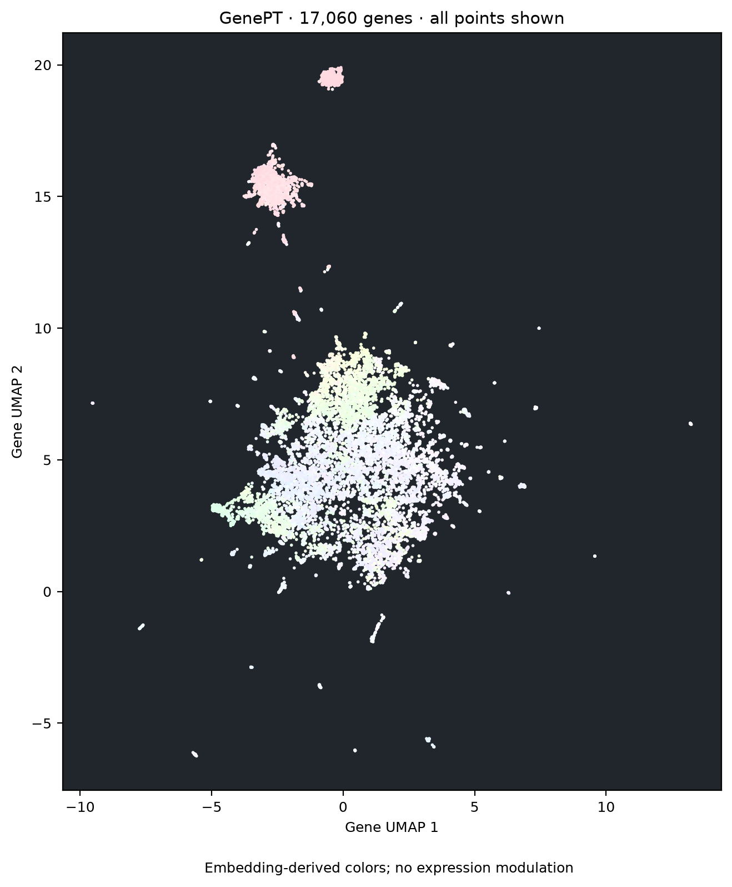
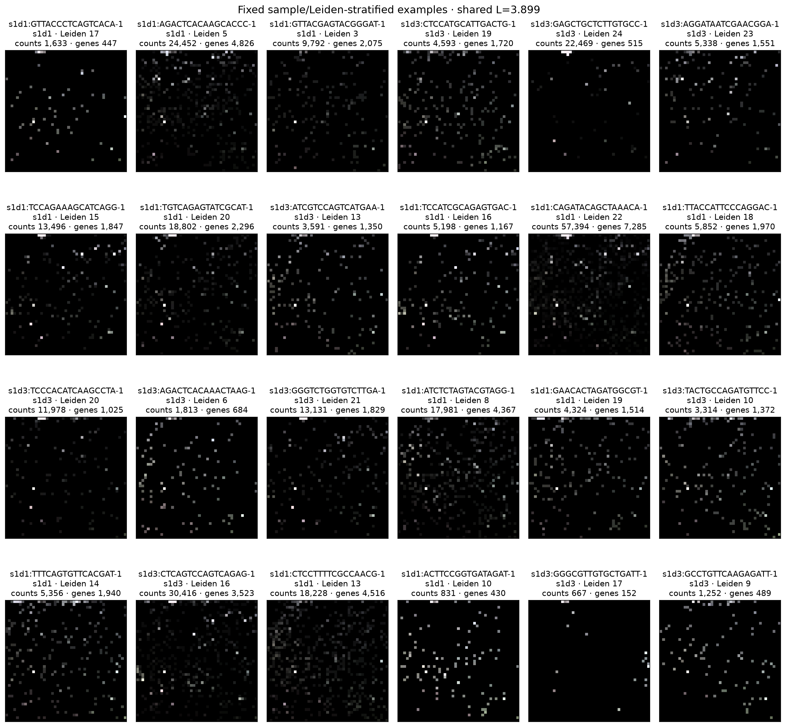

# cell2image

A mini work just for fun. I am wondering what would a cell looks like, if we trying to visualize the cell itself into an image. The basic idea would be like: the arrangement should follow the gene-gene structure, which means we should consider to use gene embedding. Then, optimal transport is used to map the gene position to a 2D image, so finally we can visualize a cell into image. 

Compact GenePT-only code for gene embeddings, a shared gene grid, numerical
cell images and visualization. It reads the existing processed expression
object; I don't know what can this repo do, to be honest. No direct pattern can be found in the images, only subtle differences could be noticed across these clusters.  

## Examples

All 17,060 matched expression genes in the GenePT embedding UMAP. Colors are
embedding-derived and do not depend on cell expression.



Real bone-marrow cells from the fixed sample/Leiden-stratified selection.
Each 45 × 45 image uses the same 2,025-gene mapping, colors and display scale.



## Run

Install the dependencies in a Python 3.11 environment:

```bash
python -m venv .venv
source .venv/bin/activate
pip install -r requirements.txt
```

Input data and generated numerical outputs are not bundled with this repository.
Set these paths in `config.yaml` before running:

- `expression`: processed H5AD, with log-normalized expression in `X`, raw
  counts in `layers['counts']`, stable gene IDs in `var_names`, gene symbols in
  `var['gene_symbol']`, and sample/Leiden/QC annotations in `obs`.
- `genept`: the precomputed `GenePT_ada.pkl` gene-vector DataFrame.
- `example_cells`: a Parquet table whose index lists the fixed example cell IDs,
  matching the H5AD's `obs_names`. Metadata are taken from the H5AD.
- `output`: the destination directory for generated results.

The default configuration retains the input paths used in the original project.
Paths are relative to the configuration file. Then run:

```bash
python run.py
```

In the original project workspace, the existing environment can be reused:

```bash
../.conda/bin/python run.py
```

Redraw saved outputs without fitting again:

```bash
../.conda/bin/python run.py --visualize-only
```

For another environment, install `requirements.txt` and run `python run.py`.
Paths in `config.yaml` are relative to that file. Large input data are referenced
in place, not duplicated. Existing analysis results are preserved.

## Files

- `core.py`: exact-symbol alignment, GenePT loading, sample-aware HVGs, UMAP,
  one-to-one assignment, fixed colors, batch encoding, decoding and gene masks.
- `run.py`: the single execution entry point and numerical exports.
- `visualize.py`: gene UMAPs, gene atlas, cell gallery, matched views, channels
  and offline HTML generation.
- `image_viewer.html`, `umap_viewer.html`: standalone viewer templates.
- `config.yaml`: input paths and the existing analysis settings.

## Representation

`GenePT_ada.pkl` supplies precomputed 1,536D gene vectors. Unique exact gene
symbols link them to the expression object's stable Ensembl IDs. Original
coordinates are retained and row L2 normalized. There is no source fusion or
learned adapter. Attribution: [GenePT](https://github.com/yiqunchen/GenePT);
the input copy is from the previously verified
[Zenodo distribution](https://zenodo.org/records/15587986).

Images use 2,025 sample-aware Seurat-dispersion HVGs after excluding prefixes
`RPL`, `RPS`, `MT-` and exact symbol `EEF1A1`. Prefix rules include every matching
name, including RPS6K-related symbols. The existing full-gene log normalization,
reference cell labels, fixed example cells and global display scale are reused.

Cosine UMAP → isotropic scaling → dense squared-cost minimum assignment creates
the 45 × 45 shared grid. This is exact assignment for the fixed projection,
not full high-dimensional GW. Full-universe GenePT UMAP is computed separately
for all 17,060 matched expression genes, without the imaging exclusions.

Weights are `softmax(PCA3(E) / 2)` with deterministic PCA signs and no component
rescaling. Numerical float32 images are `expression × weights`; summing channels
recovers retained-gene expression. Display PNGs use
`clip(log_expression / L, 0, 1) × weights / max(weights)` with the same fixed
`L=3.89857816696167` for every cell and sample. They are not numerical tensors.
Full-universe and HVG-subset UMAP/color PCA fits are separate.

## Outputs

- `outputs/viewer.html`: 32-cell image explorer with filters, gene search,
  hover, layouts and channels.
- `outputs/gene_umap.html`: all matched gene points with search and hover.
- `outputs/figures/`: seven PNG/PDF pairs.
- `outputs/gene_grid_mapping.parquet`, `occupancy_mask.npy` and
  `gene_rgb_weights.parquet`: the fixed atlas.
- `outputs/images/`: up to 256-cell raw/log float32 tensors, reference values,
  cell identities and 32 display PNGs. Gene order is the mapping's row order.
- `outputs/gene_embedding.npy`, `genes.parquet`, `gene_projection.parquet`,
  `color_pca.npz`: imaging representation and transformations.
- `outputs/full_embedding/`: the full matched representation and projection.

For all-cell streaming, use `core.image_batches(expression, mapping, weights)`;
it does not allocate every cell's image in RAM. `decode_expression` and
`gene_mask_to_pixel_mask` use the same mapping order. Samples are descriptive
labels and Leiden clusters are exploratory; no biological channel names are assigned.
